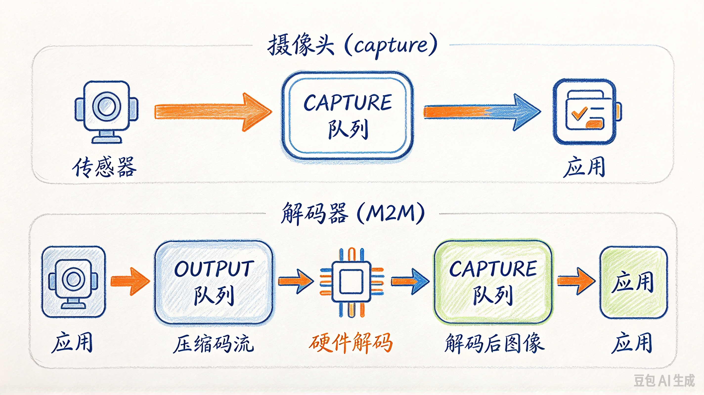

# Chromium 浏览器视频播放 V4L2 硬件解码方案分析

在维护浏览器产品的过程中，我碰到最多的问题就是与硬件加速相关的问题，这其中在信创系统下，视频播放硬件解码问题又占了大头。前不久接手了一个与 Chromium 浏览器有关的视频播放硬件解码项目，发现其采用的是 V4L2 硬件解码方案。

看到 V4L2，我脑海中立马泛起了疑问：这不是摄像头相关的技术吗？为此我还特意确认了一下，确实是 V4L2 硬件解码方案。要知道，在 Linux 系统上，使用得最多的视频加速方案是 VAAPI。关于 VAAPI，我之前写过一篇文章《[Linux 系统下的硬件视频加速](https://mp.weixin.qq.com/s/wpMLu5npIwZZiWMusz83IQ)》。至于 V4L2 硬件解码方案，则是我的知识盲区。为此我研究了相关资料，阅读了 Chromium 源码，特此和大家分享一下。

开始之前，先简单介绍一下 V4L2 是什么，为什么它能用来硬件解码？

这一切，得从摄像头 API 说起。

## V4L2

V4L2（Video for Linux 2）是 Linux 内核的视频设备框架，1998 年随 Linux 2.2 引入，历史相当悠久。它最初就是为了解决一件事：让应用程序以统一的方式访问摄像头。今天你在 Linux 上打开摄像头、用 OBS 采集画面，底层走的就是 V4L2，设备以 `/dev/video0` 这样的文件呈现，应用通过 ioctl 完成格式协商、缓冲区申请和数据读取。这就是它作为**摄像头 API**的一面。

如果故事到此为止，V4L2 和视频解码不会有任何关系。转折点在于 SoC 厂商带来了全新的需求。

### M2M：把解码硬件塞进采集框架

手机和开发板 SoC（RK3588、MTK 天玑、骁龙等）里都有一块独立的视频解码 IP：输入 H.264/H.265 压缩码流，输出 YUV 图像帧。它不画图、不拍照，本质上是一个**内存进、内存出**的转换器，业界称为 M2M（mem-to-mem）设备。以 RK3588 的 RKVDEC 为例，它是和 GPU 完全独立的硬件模块，不存在**GPU 厂商视频栈**，VAAPI 这类依赖 GPU 用户态驱动的方案在这里没有落点。

V4L2 恰好有一条为这类设备准备的通道。摄像头只有采集一个方向的数据流，而 M2M 设备有两个：

应用把码流 QBUF 进 OUTPUT 队列，硬件解完后通过 CAPTURE 队列 DQBUF 取出图像帧，中间用 `poll()` 等待完成。采集框架里的缓冲区管理、格式协商、dma-buf 导出等基础设施全部复用，厂商只需写一个内核驱动，就能同时获得这一切。于是瑞芯微、MTK、高通、三星、全志的解码器清一色以 V4L2 M2M 驱动的形式进入内核。V4L2 就这样从摄像头 API 变成了 ARM Linux 上视频硬解的事实标准。

## Chromium 与 V4L2

回顾 Chromium 在 Linux 上的视频解码演变史，十余年间大致走了四步：

1. 2013 年前后为 Chrome OS 设计 VDA 加速接口，硬解是 Chrome OS 专属。

2. 随后媒体栈 Mojo 化，解码搬进 GPU 进程。

3. 2019 年前后重构出统一的 VideoDecoderPipeline，dma-buf 帧池、零拷贝渲染有了标准框架，V4L2 后端也分化出 stateful/stateless 两条路。

4. 2021 年后随着内核社区淘汰 stateful 模式，官方转向基于 Request API 的 stateless 解码器，同时桌面 Linux 的 VAAPI 正式解禁。

Chromium 的 `media/gpu/v4l2` 后端正是为这类设备而写，最初服务于 Chrome OS 上的 ARM 设备，代码现成、久经考验，是 V4L2 解码 API 最大的软件用户。

而对于 RK3588 这类内核里没有现成 V4L2 解码驱动的平台，还有一种更曲折的玩法：Rockchip 的 libv4l-rkmpp 以 V4L2 插件的形式在用户态模拟出一个解码设备，把 Chromium 发出的 V4L2 调用翻译成私有媒体库 MPP 的调用——应用以为自己在和内核驱动对话，实际背后是 MPP。这套方案虽然 hack 味十足，却让 Chromium 在没有内核驱动的平台上跑通了硬解。

## 国产信创平台的视频硬件解码

信创系统百花齐放，所以信创场景更加复杂。国产平台的硬解能力，很大程度上是拼硬件配置拼出来的。

**飞腾（Phytium）**是纯 CPU（ARM64 核），桌面/笔记本型号基本不带 VPU，硬解能力完全取决于搭配的显卡：

| 整机配置 | 解码路径 | 实际体验 |
|---|---|---|
| D2000/FT-2000 + AMD RX550（党政机最常见配置） | VAAPI（Mesa radeonsi） | 最好，标准路径 |
| + 景嘉微 JM7/JM9 | 无 VAAPI，私有 SDK | 基本只能软解 |
| + 摩尔线程 MTT S80 | 厂商 VAAPI（非主线，完善中） | 依赖驱动版本 |
| + 芯动 Innosilicon | 自家闭源栈 | 看发行版适配 |

**华为麒麟**（擎云笔记本 L410/L420，麒麟 990/9006C）的情况和 RK3588 更像：

- SoC 内置海思自研 VDEC/VENC 硬件（与手机上同一套 IP），Mali-G76 只管渲染，不做视频解码；
- 内核是华为/UOS 定制树，海思 SDK 较新版本里有 V4L2 M2M 形态的 VDEC 驱动，但它是否进发行版内核、Chromium 是否启用 V4L2 后端，完全看 UOS/麒麟的适配补丁；
- 华为维护了一套 OMX 硬件解码方案，实际在产品中使用坑很多，实际上不少擎云机器上，浏览器播放视频仍是软解兜底。

**海光（Hygon）**和**兆芯（Zhaoxin）**这两家 x86 阵营的情况则相对省心，因为它们都沾了 AMD 的光：

- **海光**的 CPU 核源自 AMD Zen 架构授权，整机通常搭配 AMD 显卡（或海光自家的 DCU，同样源自 AMD GPU IP）。有 AMD 显卡在，Mesa 的 VAAPI 驱动就能直接工作，是国产平台里硬解体验最接近主流 x86 的一档；
- **兆芯**的 GPU 部分来自其收购的 S3 Graphics 技术积累，KX-6000 系列之前的集成显卡性能孱弱且没有 VAAPI 支持，基本只能软解；近年与 ATI 技术合作后的新一代集成显卡开始提供 VAAPI 实现，但成熟度和 H264 / H.265 profile 覆盖仍在追赶，各发行版适配程度不一。

## 小结

V4L2 从摄像头 API 成长为 ARM 平台视频硬解的事实标准，靠的是 M2M 模型对解码硬件的天然契合，而 Chromium 凭借 Chrome OS 时代的积累，成了这条路径上最成熟的软件用户。至于具体到一帧 H.265 码流如何在 V4L2 方案中走完整条解码链路，一般需要硬件厂商适配好。作为应用开发者而言，只需了解即可。
