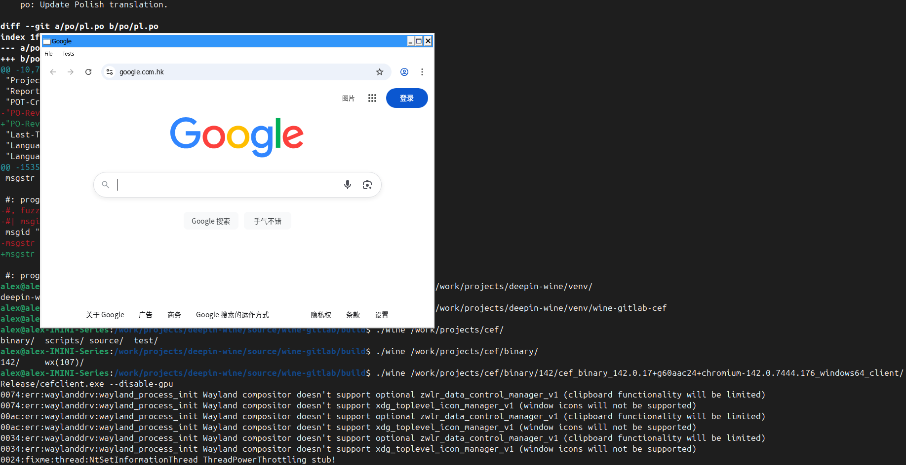

# 智谱GLM 5。4模型实测，补齐Wine Wayland跨进程渲染的另一半拼图

在上一篇文章《[上游正式合入！Wine 有了 Wayland 跨进程渲染方案，CEF 类 Windows 应用有望告别白屏](https://www.baidu.com)》中，介绍了上游的 Wine Wayland 跨进程渲染方案。该方案在不引入新的 Wayland 协议的前提下，解决了 Wayland 下跨进程渲染的难题。但这个方案还不够完美，因为它只实现了 GPU 渲染模式，纯软件渲染模式下无效。对于很多 CEF 类应用来说，为了更好的兼容性，在对性能要求不高的场景下，通常是主动关闭了GPU渲染的，这类 Windows 应用在 Wayland 下的问题依然没有解决。

前天，智谱低调发布了最新 AI 大模型 GLM 5.4，而不是传说很久的 GLM 5.5。在大模型测试榜单上排名开源模型第一名，正好我订阅的智谱 Coding Plan 可以用上，所以我就第一时间切换到了这个模型上。

我个人对于评测排名是不太感冒的，但想着前几天 Anthropics 的大模型都攻克了黎曼猜想这一数学难题，GLM 5.4 虽然比不上 Anthropics 的大模型，但解决这类编程难题，应该手到擒来。

GLM 5.4 采用了 loop 架构，据说非常费时间和tokens。所以我安排到晚上的时间来做这一项工作，不用在电脑前盯着，晚上tokens费用还有折扣。

在经历一晚上（实际上用了5小时后，由于Coding Plan的限额就停止了，早上起床后做了一些收尾工作）的 vibe coding 后，得到了我想要的结果。

