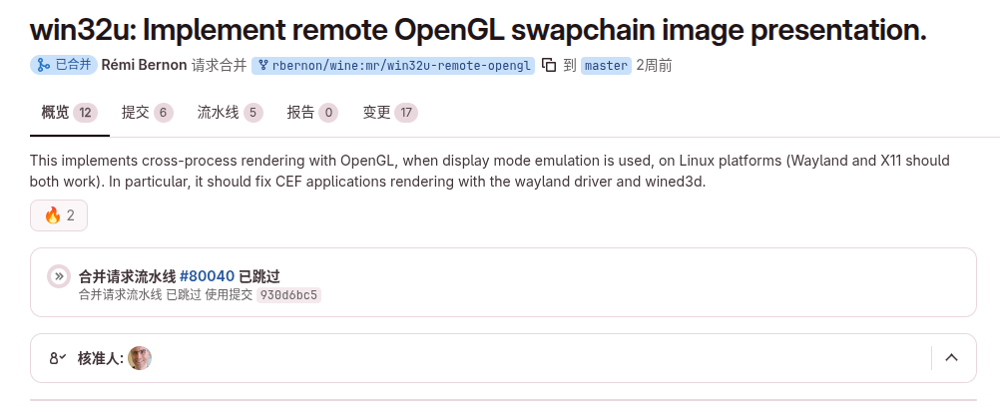
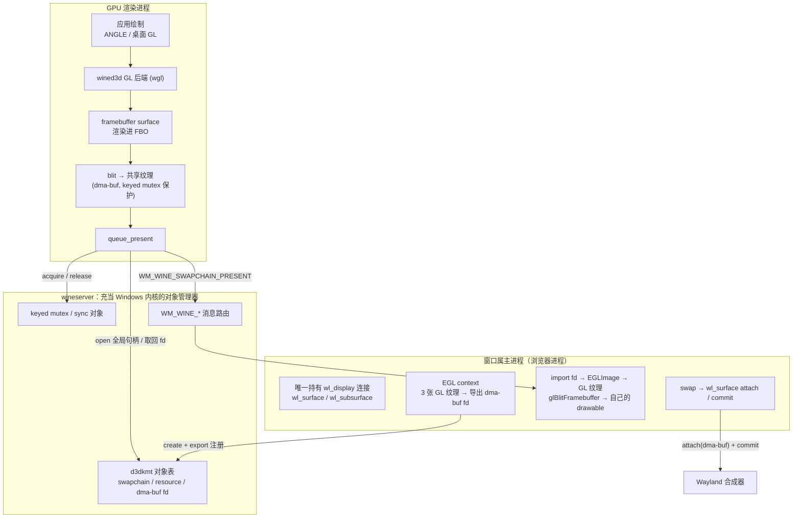
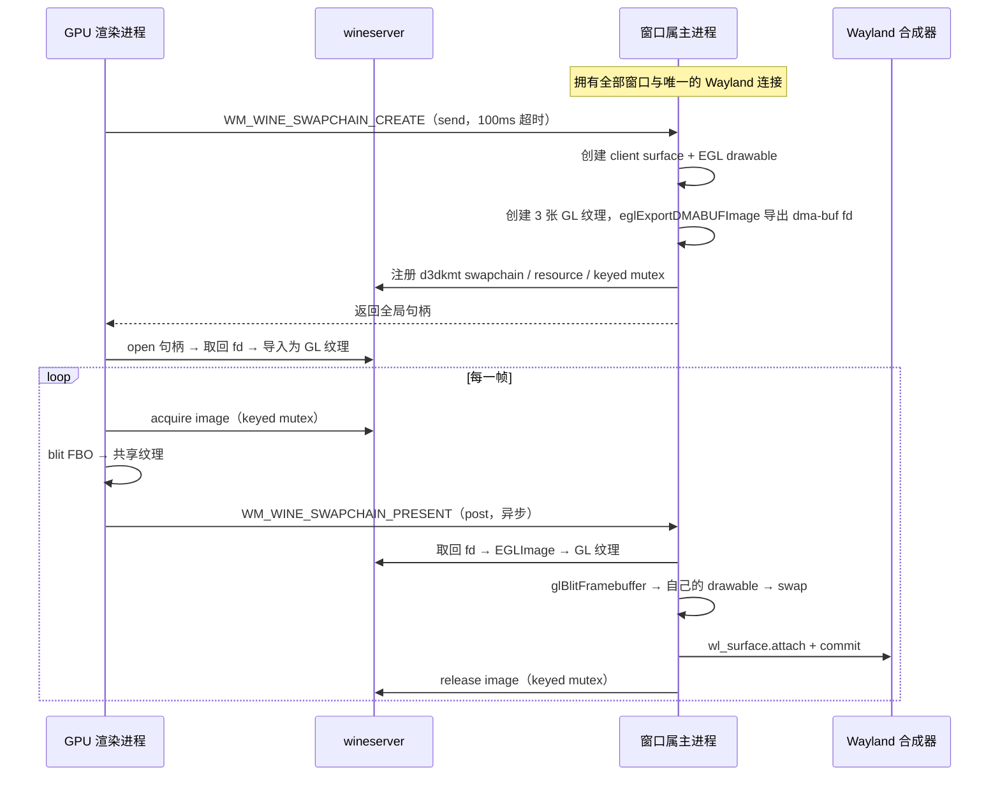

# 上游正式合入！Wine 有了 Wayland 跨进程渲染方案，CEF 类 Windows 应用有望告别白屏

> 昨天，我在查看 wine 上游提交记录时，发现合入了一个新提交： https://gitlab.winehq.org/wine/wine/-/merge_requests/12506，首次在 win32u 层实现了**跨进程 OpenGL 呈现**。提交说明直言目标："它应当修复 CEF 应用在 wayland 驱动 + wined3d 下的渲染"。为此，我拉取了 master 分支最新代码，切换到 wayland 模式，验证 CEF 官方示例 cefclient（Chromium 142），确实页面正常渲染，不再白屏了。



## 一、难在哪：Wayland 的"窗口所有权"安全模型

近一年来，deepin-wine 团队一直在进行 wine wayland 适配工作，也取得了很大的进展，所以对 wine wayland 适配的难点还是非常清楚的。

先看 Windows 上 CEF 是怎么工作的。Chromium 是多进程架构：浏览器进程拥有所有窗口（HWND），GPU 进程负责真正的绘制。渲染产物通过共享纹理 / DirectComposition 表面交给浏览器进程合成上屏。这一切成立的前提，是 Windows 的窗口模型对"跨进程"非常宽容：

| | Windows | Wayland |
|---|---|---|
| 窗口句柄 | HWND 全局有效，跨进程可用 | `wl_surface` 只属于创建它的 client 连接 |
| 谁能画窗口 | 任何进程都能 `GetDC(别人的HWND)` 往里画 | 只有属主连接能 `attach` buffer、`commit`、创建 subsurface |
| 共享机制 | 内核级：D3DKMT 共享句柄、GDI、DComp | 协议级：`linux-dmabuf` / `wl_shm`，介质是 fd |
| 安全边界 | 内核/系统服务仲裁 | 合成器按连接鉴权，进程间互不可见 |

关键矛盾在于：**Wayland 禁止进程 B 直接操作进程 A 的窗口**。当然，Wayland 协议并不禁止进程 B 画的内容出现在进程 A 的窗口里，为此设计了`linux-dmabuf` 协议，协议初衷就是跨进程共享 GPU 缓冲，fd（dma-buf）是整个 Linux 图形栈的标准共享介质。

有了 linux-dmabuf 协议，真正的难点只有两个：

1. 谁来完成只有属主能做的"attach + commit"；
2. 像素如何安全地跨进程搬运、同步。

为什么 wine 的 X11 驱动从来没有这个问题：X11 的 drawable 是 server 全局的，任何 client 都能往里画。而 wayland 驱动下，GPU 进程无法操作别的窗口。

## 二、方案：控制权留在属主进程，内容走 fd，协调走 wineserver

注意，这套跨进程渲染方案依赖于其它几个早期提交：

- **2024-11**：`EmulateModeset` 注册表开关，引入 framebuffer surface 模式，让 GL 渲染进 FBO 而非窗口原生 surface；
- **2025-10 ~ 12**：win32u 的 client surface 体系成型，且支持为"其他进程的窗口"创建 client surface；

### 架构总图



### 一次渲染的生命周期



### 四个关键设计

**1. 呈现权与渲染权分离**。当渲染进程对"外部进程窗口"调用 `wglSetPixelFormat`/`SwapBuffers` 时，win32u 检测窗口不属于当前进程，切换到 framebuffer surface 路径：GL 只往 win32u 管理的 FBO 里画，**从头到尾不碰任何窗口原生 surface**。最终 `wl_surface.attach/commit` 只由属主进程执行。

**2. 像素搬运走 dma-buf fd，经 wineserver 传递**。属主进程创建 3 张 GL 纹理，用 `EGL_MESA_image_dma_buf_export` 导出 dma-buf fd（带 fourcc/stride/offset/modifier 元数据），注册为 d3dkmt resource 对象；渲染进程 `open` 全局句柄后经 `wine_server_handle_to_fd()` 取回 fd，用 `EGL_EXT_image_dma_buf_import` 导入为纹理。fd 经 wineserver 传递，与 Wayland 经 socket 传 fd 完全同构，是设计内机制而非绕过。

**3. 三缓冲 + keyed mutex 同步**。`Acquire/ReleaseKeyedMutex2` 配合 wineserver sync 对象，形成渲染进程写、属主进程读的三缓冲流水线，实测中 acquire/release 各 116 次、queue_present/release_image 各 112 帧，严丝合缝。

**4. WM_WINE_* 跨进程窗口消息驱动**。`WM_WINE_SWAPCHAIN_CREATE`（send，100ms 超时防挂死）、`PRESENT`（post 异步）、`DESTROY`/`INVALIDATE`（窗口销毁/重挂时清理）。这模拟的正是 Windows 语义：跨进程 HWND 本来就全局可用。

### 为什么没有破坏 Wayland 安全模型

站在合成器的视角，整个系统就是**一个普通 client（属主进程）在正常刷新自己的窗口**。GPU 进程从始至终没有对 compositor 说过一句话，没有任何 surface 权限。共享渠道是 `linux-dmabuf` 这个设计内的"正门"。跨进程协调不依赖合成器，而由 wineserver 补位 Windows 内核的角色。

## 三、如何开启（实测）

**1. 版本要求**：upstream master 2026-11-17 之后（包含 MR !12506），预计在 wine 11.23 发布版本中将出现该新特性。

**2. 打开 EmulateModeset**（远程 swapchain 目前只在显示模式模拟路径生效）：

```bash
# 注意：即使使用 wayland 驱动，选项也放在 "X11 Driver" 节下（历史命名，win32u 全局读取）
wine reg add "HKCU\\Software\\Wine\\X11 Driver" /v EmulateModeset /t REG_SZ /d y
```

**3. 驱动要求**：Mesa 系驱动（导出依赖 `EGL_MESA_image_dma_buf_export`，导入依赖 `EGL_EXT_image_dma_buf_import(_modifiers)` + `GL_EXT_EGL_image_storage`）。

**4. 实测记录**：wine master + winewayland 驱动 + cefclient 142（Chrome runtime），开启开关后页面渲染成功。用 `WINEDEBUG=+opengl,+d3dkmt` 可以看到整条链路的痕迹：`Created swapchain` / `Opened global ... swapchain`（属主进程创建、渲染进程打开）、`d3dkmt_swapchain_queue_present` / `release_image` 成对出现、keyed mutex acquire/release 有节奏地交替。

## 四、优缺点与展望

**优点：**

- **不破坏 Wayland 安全模型**：控制权留在属主进程，内容走 fd，合成器零感知、零改动；
- **层次选得好**：实现在 win32u 公共层而非单个图形驱动里，wayland / X11(EGL) 通吃，所有走 GL 呈现的跨进程应用一次受益；
- **语义对齐 Windows**：跨进程渲染在 Windows 上本就合法，wine 只是补齐了 Linux 侧的等价物；
- **复用既有基础设施**：wineserver 对象、窗口消息、client surface，不引入新协议、不需要合成器配合。

**局限：**

- **仅覆盖 GL 路径**：wined3d GL 后端 / 桌面 GL 应用可用；DXGI/D3D 原生 swapchain、Vulkan 尚未接入；
- **Chromium 的主路径还没修好**：Chromium 142 的首选输出是 DirectComposition 共享表面，而 wine 的 `dcomp` 目前是纯桩（`DCompositionCreateDevice2/3` 返回 `E_NOTIMPL`），CEF 走的是"回退到 swapchain"路径。补全 dcomp 才是长期正道；
- **性能开销**：FBO→共享纹理→属主 drawable 两次 GPU blit，且每帧一次跨进程消息，非零拷贝方案；
- **依赖 Mesa 扩展**：NVIDIA 私有驱动暂不可用；
- **EmulateModeset 是全局开关**：会改变 `ChangeDisplaySettings` 与 gamma 的语义（全屏游戏靠它"假切换分辨率"），默认未开启；
- **属主进程必须有消息泵**：present 靠 post 消息驱动，无消息循环的宿主进程拿不到画面。

**展望**：d3dkmt 共享资源、keyed mutex、跨进程对象 open 这些地基已经铺好，后续大概率会看到 dxgi/wined3d 接入远程 swapchain（覆盖 D3D 路径），以及 wine `dcomp` 的逐步实现。

## 结语

这个 MR 最漂亮的地方在于它对"边界"的理解：**Wayland 收走的是窗口控制权，不是内容共享权**。控制权老老实实留给属主进程，内容用 Linux 图形栈的标准介质（dma-buf fd）搬运，协调交给早已存在的 wineserver。没有 hack 合成器，没有新协议，却在协议安全模型内完整复刻了 Chromium 在 Windows 上的真实架构。CEF 类应用在 wayland 下白屏的日子，终于开始进入倒计时了。

---

*参考：*
- *MR !12506: <https://gitlab.winehq.org/wine/wine/-/merge_requests/12506>*
- *EmulateModeset 引入提交: wine `21623338ab8`（2024-11）*
- *本文实测环境：wine master（2026-11-18）+ winewayland.drv + Mesa，CEF 142 cefclient*
